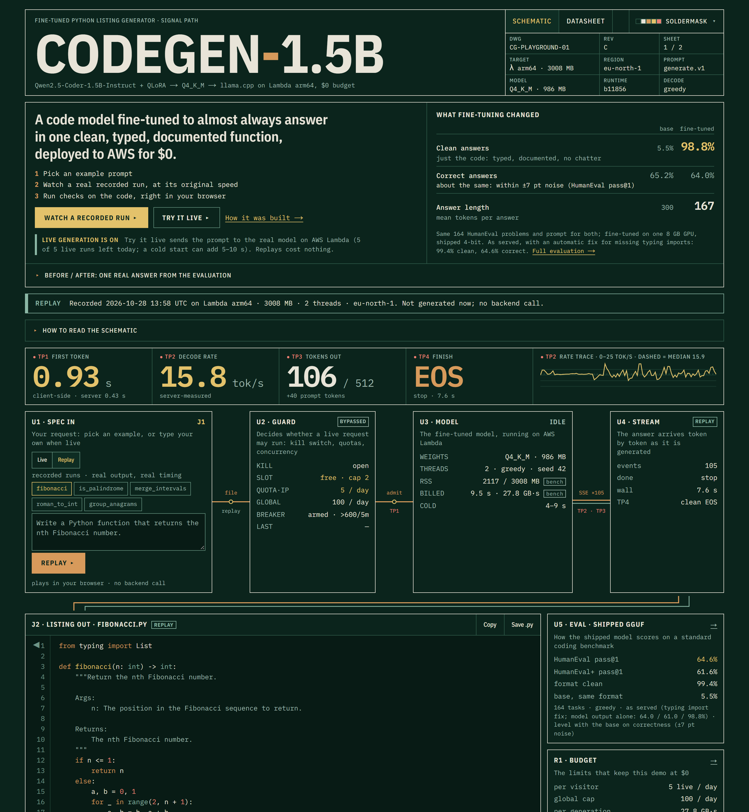
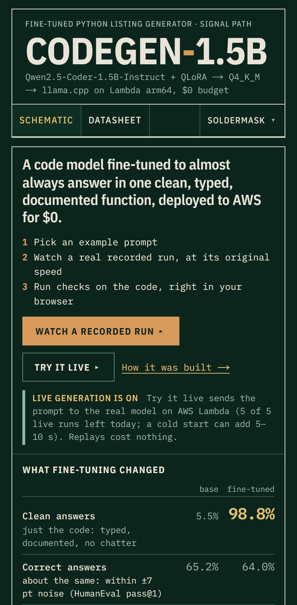
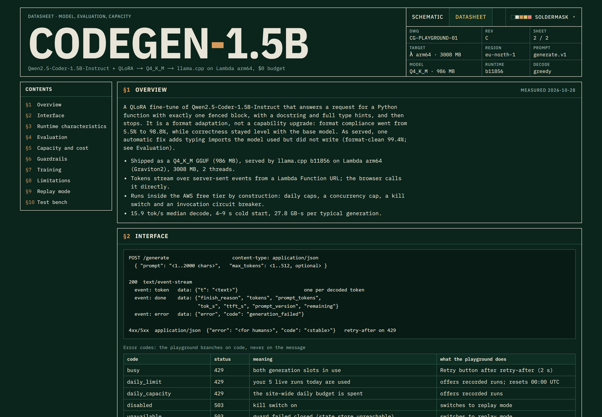
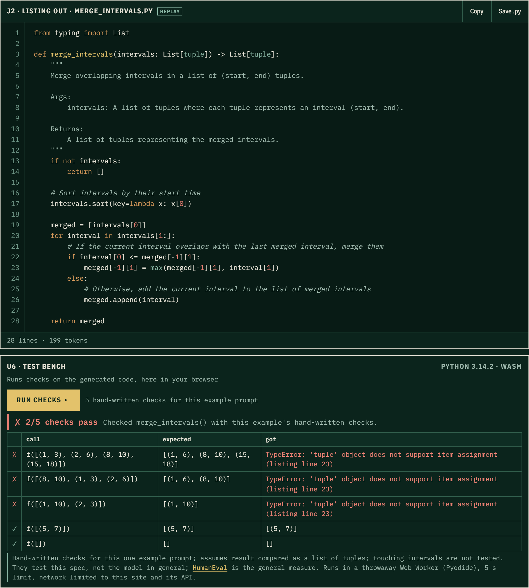

# AWS codegen 1.5B

A small code model, fine-tuned on one consumer GPU, served from AWS Lambda for about $0, with a browser playground
that streams its output and runs it.

**Live site: https://d2js86b0xg0ozs.cloudfront.net**

The site opens on **recorded real runs** (labelled as recordings, played back with their original timing). Live
generation is **on** (since 2026-10-29): **Try it live** sends a request to the real model, up to 5 per visitor per day
within a shared daily cap, and the operator can pause it at any time, in which case the site stays on recordings.


<sub>The playground with live generation on: a recorded run has just played back (the default); <b>Try it live</b> sits next to it.</sub>



## What it is

- **Model:** Qwen2.5-Coder-1.5B-Instruct, QLoRA fine-tuned to answer with exactly one fenced Python block: type hints,
  a docstring, and no prose around it. It is exported to GGUF Q4_K_M (986 MB).
- **Serving:** llama.cpp (b11856), cross-compiled for arm64, in a Lambda container image. It runs on Graviton2 at
  3008 MB and streams server-sent events through a Function URL.
- **Guardrails:** daily quotas per IP and globally, a 2-slot concurrency cap, a two-layer kill switch and an invocation
  circuit breaker. They are what keep the worst case inside the Lambda free tier.
- **Frontend:** a static Next.js export on S3 and CloudFront with a strict CSP. It also runs the generated code in the
  browser with Pyodide (WebAssembly) and checks it there. Recordings are the default; a live run is the visitor's
  explicit choice, and a slow first request says it is waking the model rather than looking frozen.

## Results (measured 2026-10-28)

HumanEval, 164 problems, greedy decoding:

| | Base bf16 | Fine-tuned bf16 | Shipped Q4_K_M, model output | **Shipped, as served** |
|---|---|---|---|---|
| HumanEval pass@1 | 65.2% | 70.1% | 64.0% | **64.6%** |
| HumanEval+ pass@1 | 59.1% | 66.5% | 61.0% | **61.6%** |
| Format-clean (one block, typed, documented) | 5.5% | 100% | 98.8% | **99.4%** |
| Mean response tokens | 300 | 167 | 167 | **167** |

"As served" (2026-10-29) adds one generation-time fix: a typing name used in a type hint but not imported gets its
import added, and the playground marks the line. It is a shipped mitigation, not a retrain, and changes 1 answer of 164.

The fine-tune's main win is **format**, not accuracy. The bf16 accuracy gains are not statistically significant on
164 problems (paired McNemar p = 0.26 and 0.08), and 4-bit quantization gives most of them back. The full analysis,
the contamination check and the paired tests are in [docs/eval_report.md](docs/eval_report.md), which also has:

- **Where it fails:** all 65 failing HumanEval tasks, categorised. The largest group (30) is spec reading, dropping a
  stated rule or solving a neighbouring problem, and 25 of those 30 fail for the base model too.
- **A tuple-immutability probe** (40 fresh tasks): assigning into a tuple happens for base and fine-tuned alike, 3 of 40
  each, so it is inherited, not caused by the fine-tune. The fine-tuned model's bigger problem there was missing
  typing imports, which the shipped fix addresses (23 to 27 of 40, against the base model's 24).

On Lambda the model decodes at about 15.9 tok/s (11.7–19.1). A cold start takes 4–9 s and a typical generation is
billed about 9.5 s. Details: [docs/backend_capacity.md](docs/backend_capacity.md).

The site's datasheet page (`/notes`) has these numbers alongside the API, guardrails, training details and limitations:



### The in-browser test bench

Each of the five example prompts has a small hand-written check suite. The playground runs the generated code against
it in a Web Worker, with a 5 s limit. The recorded runs score:

| Example | Checks |
|---|---|
| fibonacci | 5/5 |
| palindrome | 5/5 |
| roman numerals | 5/5 |
| anagram groups | 4/4 |
| merge intervals | **2/5**: the model assigns to an element of an input tuple, which raises `TypeError` (the base model makes the same mistake; see the probe above) |



The failure is real and stays visible. Custom prompts get a behavioural report only (does it parse, does it run, what
does it define), never a pass/fail.

## How it is built

```
browser ── CloudFront ── S3 (static site, status.json)
   │
   └── Lambda Function URL (streaming) ── guard (DynamoDB: quotas, slots, kill flag)
                                       └── llama-server (Q4_K_M GGUF, arm64)
CloudWatch alarm ── SNS ── breaker Lambda: kill flag on + URL locked + status.json "circuit breaker"
```

| Folder | Contents |
|---|---|
| [`training/`](training/) | Data pipeline (self-distilled from the base model, execution-filtered), QLoRA training, HumanEval eval harness, merge/export |
| [`backend/`](backend/) | Lambda app: request guard, SSE streaming around llama-server, Dockerfile, tests and benchmarks |
| [`infra/`](infra/) | CloudFormation/SAM stacks (backend, frontend, ECR, state table), kill switch, live test suites |
| [`frontend/`](frontend/) | Next.js playground, `/notes` datasheet, replays, Pyodide test bench, unit/browser/accessibility tests |
| [`docs/`](docs/) | Eval report, model card, capacity and cost measurements, runbook |

Model weights are not in the repository. See [model-artifacts/README.md](model-artifacts/README.md) and
[docs/model_card.md](docs/model_card.md).

## Cost

All of it is designed to stay in the AWS free tier. The global cap of 100 generations a day keeps even maximum-length
cold runs under the 400,000 GB-s monthly Lambda allowance (about 329,000 GB-s at worst). The remaining costs are ECR
storage for the image (cents a month) and a one-time ~270 GB-s per image deploy. The circuit breaker pauses everything
if invocations go above 600 in 5 minutes.

## Running it

- **Operating the deployment** (going live, pausing, deploying, recording replays): [docs/runbook.md](docs/runbook.md)
- **CI:** every push and pull request runs the frontend, backend guard and CPU-only training tests and builds the site;
  deploys stay manual ([runbook](docs/runbook.md#tests)).
- **Training and evaluation:** [training/README.md](training/README.md), [training/SETUP.md](training/SETUP.md)
- **Frontend locally:** `cd frontend && npm ci && npm run dev`, then http://localhost:3000. Recordings work offline;
  Try it live talks to the real backend (which allows `localhost:3000`) when it is on. Local dev has no status.json,
  so the page treats the backend as reachable and lets the first request decide.

## License

[MIT](LICENSE). The base model, Qwen2.5-Coder-1.5B-Instruct, is Apache-2.0. The training prompts come from
[bigcode/self-oss-instruct-sc2-exec-filter-50k](https://huggingface.co/datasets/bigcode/self-oss-instruct-sc2-exec-filter-50k).
